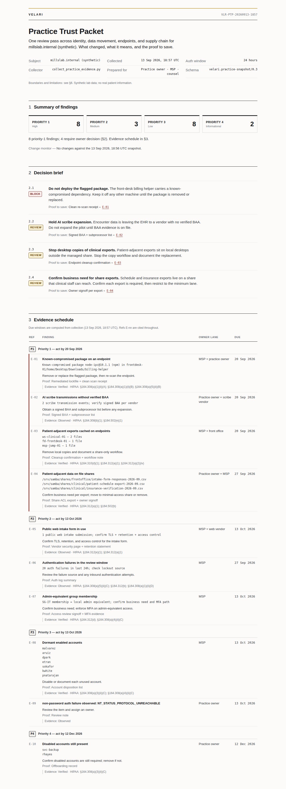

# Practice Trust Lab

[](https://github.com/itsnmills/practice-trust-lab/actions/workflows/ci.yml)

**A synthetic small-clinic environment that produces real, dated, no-PHI security evidence.**

The lab stands up a fake medical practice — Active Directory domain, domain-joined
endpoints, clinical file shares, a mock EHR with AI-scribe egress — and an evidence
pipeline that turns it into a client-ready review packet. Findings are genuine
detections; every patient, vendor, and record is synthetic by design.

This exists because healthcare security problems are easy to describe and hard to
prove, and real clinics are off-limits for portfolio work. So the environment is
built instead.



## What it demonstrates

- **Identity and access:** Samba AD domain with AGDLP group nesting, least-privilege
  share ACLs, lockout policy, dormant-account review
- **Patient data outside the EHR:** clinical exports on shares and cached on endpoint
  desktops, proven by SHA-256 equality between the two
- **AI scribe risk:** simulated transmissions to vendors with unverified BAA status
- **Supply chain:** package-exposure scan (optional Bumblebee integration) catches a
  planted shadow-IT app pinned to a known-compromised npm release
- **Drift detection:** each run diffs against the previous snapshot — new/resolved
  findings, account and group changes, file-hash changes, endpoint copy changes
- **Evidence packaging:** decision brief, evidence schedule with stable refs,
  reviewer lanes, change monitor, limitations and attestation — print-grade output
- **Regulatory routing:** every finding group is tagged with the HIPAA Security Rule
  and Privacy Rule provisions it is relevant to (see below)
- **Evidence integrity:** a hash-chained ledger you can verify with one command

## Architecture

```
Samba AD DC (millslab.internal)                     clinic-ehr (mock EHR, :8095)
├── OUs / AGDLP groups / lockout policy             ├── synthetic patient roster
└── File shares with AD-group ACLs                  ├── public web intake form
    ├── ClinicalShare    (schedules, insurance)     └── AI-scribe egress simulation
    ├── FrontOfficeShare (intake responses)
    └── ITShare          (admin runbooks)

Endpoints (all domain-joined)
├── ws-clinical-01  syncs clinical exports to a local desktop
├── fd-frontdesk-01 carries a planted shadow-IT app (compromised dependency demo)
└── msp-jump-01     outsourced-MSP admin box with IT + front-office access

evidence/collect_practice_evidence.py   read-only pass -> JSON/Markdown snapshot
evidence/render_practice_snapshot.py    snapshot -> client-facing HTML packet
```

Everything runs in Docker on your own machine. Published ports bind to `127.0.0.1`
by default (`LAB_BIND_IP` in `samba-dc/.env` if you want a VPN interface).

## Quickstart

Requirements: Linux with Docker Compose v2, Python 3.10+, and `openssl`
(tested on Ubuntu 24.04).

```bash
git clone https://github.com/itsnmills/practice-trust-lab.git && cd practice-trust-lab
./scripts/bootstrap.sh        # network, volume, credentials, domain, shares, endpoints
./scripts/seed-scenario.sh    # plant the shadow-IT app (supply-chain demo)
./scripts/run-evidence.sh     # collect a snapshot and render the packet
```

Open `evidence/latest.html`. A pre-rendered example lives at
[`examples/sample-packet.html`](examples/sample-packet.html).

To tear the lab down (safe to re-run; `--dry-run` shows what it would remove):

```bash
./scripts/teardown.sh --yes
```

`./scripts/verify-boundaries.sh` checks the access boundaries the lab claims (clinical
users can read `ClinicalShare`, IT is denied it, temporary-password accounts cannot
sign in) against the running lab and exits non-zero on any deviation.

Generated runtime files (`samba-dc/.env`, `*/home`, `*/logs`, `clinic-ehr/data`)
are left in place; delete them for a pristine tree.

## The evidence pass

One read-only pass collects:

| Section | Signals |
|---|---|
| Identity | users, enabled/disabled, never-logged-on, stale, password/lockout policy, privileged groups |
| Shares | file inventory with SHA-256 prefixes, patient-adjacent detection |
| Authentication | parsed domain auth audit, success/failure counts, failure reasons |
| EHR surface | portal health, intake submissions, scribe transmission events |
| Endpoints | local copies per endpoint, hash-matched against share files |
| Supply chain | package-exposure findings (optional: requires a configured scanner) |

Output per run: `evidence/artifacts/<date>/snapshot-*.json` + `.md` + `.html`,
plus one line in `evidence/ledger.jsonl`. Each snapshot carries a
**change monitor** diffed against the previous run.

### Tamper-evident ledger

Every ledger entry records the SHA-256 of the snapshot file's exact bytes and the
hash of the previous entry, so the ledger is a hash chain. Editing a snapshot,
editing or deleting an entry, or reordering them is detectable:

```bash
python3 evidence/collect_practice_evidence.py --verify-ledger
# ok: 4 chained entries checked        (exit 0)
# FAIL: line 3: snapshot modified since collection: artifacts/...   (exit 1)
```

Appends take an exclusive lock and are fsynced; a partial final line from a crash
is quarantined to `ledger.jsonl.recovered` instead of breaking the chain.

A hash chain alone cannot stop someone who rewrites the whole ledger. Anchor the
head off-host with a checkpoint, then verify against it:

```bash
python3 evidence/collect_practice_evidence.py --checkpoint anchor.json \
  --sign hmac --key-file ~/.velari/checkpoint.key   # store anchor.json off-host
python3 evidence/verify_evidence.py evidence/ledger.jsonl --checkpoint anchor.json \
  --key-file ~/.velari/checkpoint.key
# ok: 4 chained entries checked
# checkpoint: 4 entries, head 9c1f..., exact file match
```

`evidence/verify_evidence.py` is a standalone stdlib-only verifier for auditors;
exit codes are 0 verified, 1 integrity failure, 2 usage/input error. Checkpoint
verification detects truncation, rewritten history, and a fully rebuilt chain.
Unsigned and HMAC-signed checkpoints have honest limits; SSH/OpenSSL signatures
are supported when those tools are installed. See
[Evidence integrity](docs/EVIDENCE-INTEGRITY.md) for what each layer does and
does not prove.

The supply-chain section uses [Bumblebee](https://github.com/perplexityai/bumblebee)
(Apache-2.0). Point `BUMBLEBEE_DIR` at a checkout with `bin/bumblebee` and exposure
catalogs; without it, the section is skipped cleanly.

## Development

```bash
make setup        # uv venv + editable install (falls back to python3 -m pip)
make test         # unit + e2e tests, no Docker
make lint         # ruff check
make typecheck    # mypy, advisory in CI while in-flight work lands
make cov          # branch coverage + threshold from pyproject.toml
```

Without `make`, the gate CI enforces is:

```bash
uv run --no-project --with pytest --with ruff sh -c 'ruff check . && pytest -q'
```

The suite needs no Docker: it covers drift detection, auth-log parsing, container
scoping, ledger and checkpoint tamper detection, section parsers, renderer
escaping, the HIPAA crosswalk, and the packaging/entry-point contract.

The project installs with `uv pip install -e .` (or `pip install -e .`) and has
**zero runtime dependencies**. Editable installs expose `velari-collect`,
`velari-render`, and `velari-verify`; the legacy
`python3 evidence/collect_practice_evidence.py` and
`python3 evidence/render_practice_snapshot.py` entry points keep working
unchanged. CI runs a Python 3.10-3.13 matrix, lint, typing, ShellCheck, Hadolint,
compose validation, a packet render plus HTML well-formedness check, and branch
coverage. See [docs/DEVELOPMENT.md](docs/DEVELOPMENT.md) for the full workflow,
project layout, how to add an evidence section or detection rule, and how to
regenerate golden files.

## HIPAA crosswalk

Each finding group in the packet carries the 45 CFR 164 provisions it is relevant to,
and section 5.8 lists them per evidence ref. The mapping lives in
[`evidence/hipaa_crosswalk.py`](evidence/hipaa_crosswalk.py) and is covered by tests.

| Finding | Relevant provisions |
|---|---|
| Known-compromised package | §164.308(a)(1)(ii)(A) risk analysis, §164.308(a)(1)(ii)(B) risk management, §164.308(a)(5)(ii)(B) malicious software |
| AI scribe without verified BAA | §164.308(b)(1) business associate arrangements, §164.502(e)(1) disclosures to business associates |
| Patient-adjacent exports on endpoints | §164.310(d)(1) device and media controls, §164.312(a)(1) access control, §164.312(a)(2)(iv) encryption |
| Patient-adjacent data on shares | §164.312(a)(1) access control, §164.502(b) minimum necessary |
| Public web intake | §164.312(e)(1) transmission security, §164.312(a)(1) access control |
| Authentication failures | §164.308(a)(5)(ii)(C) log-in monitoring, §164.312(b) audit controls, §164.308(a)(1)(ii)(D) activity review |
| Admin-equivalent group | §164.312(d) authentication, §164.308(a)(4)(ii)(C) access modification |
| Dormant / disabled accounts | §164.308(a)(3)(ii)(C) termination procedures, §164.308(a)(4)(ii)(C) |

This is a routing aid, not a compliance determination. It says what a finding is
relevant to, not that a provision is violated.

Every section number, heading, and required/addressable label in the registry was
checked against the current 45 CFR 164.308, .310, .312 and .502 text from eCFR
(2026-11-12). Which provision a given finding relates to is a judgment call; rules
whose subject is narrower than their group carry their own citations
(`RULE_CITE_OVERRIDES` in `evidence/practice_render/rules.py`). Not legal advice.

## Documentation

- [Architecture](docs/ARCHITECTURE.md): components, module map, snapshot and ledger formats
- [Threat model and limitations](docs/THREAT-MODEL.md): what is planted, what the tooling
  does and does not guarantee
- [Lab security](docs/LAB-SECURITY.md): intentional weaknesses vs real hardening vs remaining risk
- [Evidence integrity](docs/EVIDENCE-INTEGRITY.md): ledger, checkpoints, signing, standalone verifier
- [Snapshot schema](docs/SCHEMA.md): fields, version policy, validation, the no-PHI scanner
- [Development](docs/DEVELOPMENT.md): running everything, adding a section or rule

## Design decisions

- **Metadata only.** The collector reads policy, group membership, counts, and
  hashes. It never extracts patient content, credentials, or message bodies.
- **Scoped to the lab.** The collector reports only the lab's own containers, so
  running it on a shared Docker host never leaks unrelated workloads into a packet.
- **Read-only by contract.** The evidence pass does not remediate; it produces
  asks with proof-to-save for the owner lane.
- **Negative tests are part of the demo.** Clinical users can read `ClinicalShare`;
  IT is denied there but allowed `ITShare`; temporary-password users cannot
  authenticate. Those boundaries are verified, not assumed.
- **Synthetic boundary.** `millslab.internal`, its users, and its patients exist
  only in this lab. Nothing here is a compliance certification, legal advice, or
  a breach determination.

## Repo layout

```
samba-dc/          AD DC image, domain population, share provisioning, compose
clinic-ehr/        mock EHR app (Python stdlib) + compose
endpoint/          shared domain-joined endpoint image (env-configured)
workstation-01/    clinical endpoint compose + local data
frontdesk-01/      front office endpoint compose + local data
msp-jump-01/       MSP admin endpoint compose + local data
evidence/          collector package (practice_evidence/), packet renderer, HIPAA crosswalk
scripts/           bootstrap, scenario seed, evidence runner
examples/          sanitized sample snapshot + rendered packet
tests/             pytest suite (no Docker required)
docs/              architecture, threat model, screenshot assets
```

## License

MIT. The Bumblebee scanner and its catalogs are separate projects under their own
licenses and are not vendored here.
